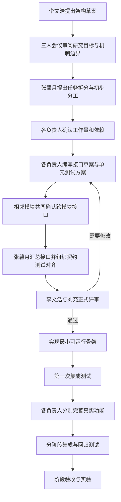

# 开发协作与接口评审流程

本文规定项目从架构构思、任务拆分、接口设计、测试设计、正式实现到集成验收的基本流程。目标是让四个开发子系统能够并行推进，同时避免接口不一致、责任边界模糊和最后阶段集中返工。

## 一、基本原则

1. **先明确研究问题和模块边界，再讨论具体实现。**
2. **先评审接口和测试方案，再开始完整功能开发。**
3. **公共接口由提供方与使用方共同确认，不由任何一方单独决定。**
4. **模块负责人对本模块的设计、代码和单元测试负责。**
5. **张馨月负责组织、对齐和集成，不代替所有负责人完成技术设计。**
6. **只有 Engine 可以修改库存、健康、产量等世界物理状态。**
7. **市场、计划机构和 Agent 只提交行为或决策，由 Engine 校验和结算。**
8. **不同经济制度必须面对同一套环境、资源、技术和物理结算规则。**
9. **先完成最小可运行骨架，再逐步补充真实机制，不等全部实现完才第一次集成。**

## 二、角色与责任

### 李文浩：架构提出与技术评审

- 提出每个阶段的研究目标和总体架构草案；
- 明确模块边界、公平比较原则和本轮最小交付；
- 评审软件架构、LLM 接口、实验设计、复现性和技术可行性；
- 对关键技术基线和阶段验收做最终确认；
- 不替各模块负责人编写全部接口和实现细节。

### 刘充：经济学评审

- 评审市场、Lange、Cockshott 等机制的经济含义；
- 评审信息条件、价格和计划逻辑、福利指标与制度解释；
- 检查不同制度的比较是否公平；
- 提供可手算的极小经济案例或关键边界条件；
- 不承担日常任务分派和代码集成责任。

### 张馨月：开发协调与集成负责人

- 根据已经通过的总体架构提出任务拆分和初步分工；
- 维护任务依赖、交付范围和阶段状态；
- 组织相邻模块负责人对齐公共接口；
- 汇总统一接口文档，检查命名、单位、调用顺序和责任边界；
- 组织契约测试和端到端集成测试；
- 分阶段集成各模块，记录问题并退回对应负责人修复；
- 不替所有模块负责人决定输入输出、编写全部单元测试或修复全部代码。

### 各模块负责人：接口、实现与单元测试

- 在任务框架内设计本模块的具体输入、输出和内部结构；
- 与接口使用方共同确认跨模块接口；
- 编写本模块代码、单元测试和必要说明；
- 对自己提交代码的正确性和可解释性负责；
- 修复集成过程中归属于本模块的问题；
- 未经评审，不擅自修改公共接口或其他模块。

## 三、完整开发流程



### 阶段 1：提出架构草案

李文浩为本轮工作准备一份简短架构提案，至少说明：

- 本轮要回答的研究问题；
- 四个子系统及其职责；
- 哪些行为属于 Agent、市场、计划机构或 Engine；
- 必须共享的状态和信息；
- 不允许破坏的系统不变量；
- 本轮明确不做什么；
- 预期完成的最小实验或可运行场景。

架构草案用于确定方向，不需要提前规定每个类、函数和字段。

### 阶段 2：三人会议审阅

会议由李文浩、张馨月和刘充参加，重点确认：

- 研究问题是否清楚；
- 模块边界是否合理；
- 市场、Lange、Cockshott 的经济含义是否正确；
- 不同制度是否使用公平的信息和物理条件；
- 本轮最小交付是否足够小且可以验收；
- 哪些问题已经决定，哪些仍然待确认。

会议结论写入 `docs/decisions/` 或 `docs/meetings/`。未决定的问题不得由开发者自行猜测为正式规则。

### 阶段 3：张馨月提出任务框架

张馨月先给出任务的大概信息，而不是代替负责人完成技术设计。

她负责填写：

```text
任务名称：
负责人：
负责模块：
任务目标：
依赖哪个模块：
被哪个模块依赖：
本轮实现范围：
明确不做什么：
大体验收条件：
建议交付时间：
```

任务分配后，各负责人应确认工作量、依赖和交付范围。若某个任务明显过重或依赖尚未满足，应在编码前调整。

### 阶段 4：负责人补充技术设计

模块负责人继续填写：

```text
具体输入：
具体输出：
字段与数据类型：
调用方法和调用时机：
允许修改的状态：
异常和失败情况：
正常示例：
边界示例：
单元测试方案：
```

模块负责人不需要一次写出最终实现，但必须让其他模块看得懂自己需要接收什么、返回什么。

### 阶段 5：接口双方共同确认

公共接口不是单个模块的私有设计。每个接口至少指定：

- **接口负责人**：维护接口定义、示例和版本；
- **接口提供方**：产生数据或实现服务；
- **接口使用方**：确认数据足以支持自己的工作。

典型确认关系包括：

- Engine 提出 `WorldState`，LLM、市场和计划负责人确认是否够用；
- LLM 提出 `AgentAction`，Engine 负责人确认是否能校验和结算；
- 市场提出 `MarketResult`，Engine 和 Lange 负责人确认是否能使用；
- 计划模块提出 `PlanDecision`，Engine 负责人确认是否能执行；
- 劳动匹配模块提出 `LaborAssignment`，Agent 与 Engine 负责人共同确认。

确认时必须回答：

1. 谁创建这份数据？
2. 谁读取它？
3. 谁可以修改它？
4. 单位和时间含义是什么？
5. 缺失、非法或过期数据如何处理？
6. 是否存在循环依赖？

### 阶段 6：张馨月组织接口对齐

张馨月汇总各接口草案，重点检查：

- 字段名称和含义是否一致；
- 单位是否一致；
- 时间步和调用顺序是否一致；
- 状态所有权是否明确；
- 异常和非法输入是否有统一处理；
- 不同制度能否使用相同的 Engine 接口；
- 是否遗漏契约测试和端到端测试所需的信息。

统一接口应设置版本，例如：

```yaml
interface_version: "0.1"
```

### 阶段 7：分层设计测试

#### 7.1 模块单元测试

由各模块负责人设计和实现，用于验证模块内部逻辑。

示例：

- Engine：库存守恒、运输损耗、健康更新、非法状态拒绝；
- LLM：结构化输出解析、非法行为拒绝、超时与回退；
- 市场：撮合、价格形成、供需不平衡和未成交处理；
- 计划：劳动分配、资源约束和计划可行性。

每个功能至少包含：

1. 正常情况；
2. 边界情况；
3. 非法情况。

#### 7.2 接口契约测试

由相邻模块负责人共同设计，张馨月组织和维护整体一致性。

例如：

- `AgentAction` 是否一定能被 Engine 解析；
- `MarketResult` 是否满足 Engine 的结算要求；
- `PlanDecision` 是否包含完整生产、劳动和调拨信息；
- Lange 中央计划局能否读取市场的价格和超额需求反馈。

#### 7.3 端到端集成测试

由张馨月组织设计，第一版只要求一个可手算的极小案例：

```text
初始化少量 Agent
→ 生成观察
→ 产生行为
→ 市场或计划模块产生决策
→ Engine 校验与结算
→ 输出下一轮状态
```

刘充负责检查极小案例是否符合经济机制；李文浩负责检查执行、记录和复现是否完整。

### 阶段 8：正式接口评审

接口文档与测试方案完成后，由李文浩和刘充进行评审：

- 李文浩：软件架构、LLM 接口、实验可复现性、技术公平性；
- 刘充：经济机制、信息条件、目标函数、价格和计划逻辑；
- 张馨月：接口完整性、依赖关系和集成可行性；
- 模块负责人：回答实现细节、测试范围和工作量问题。

评审结果分为：

- **通过**：可以进入实现；
- **修改后通过**：完成指定修改后进入实现；
- **暂不通过**：存在关键研究或接口问题，暂不编码。

评审通过后形成接口基线。公共接口的后续修改必须说明原因、影响模块、迁移方式和新增测试。

### 阶段 9：先实现最小骨架

接口通过后，各负责人先实现最小骨架：

- 方法能够被调用；
- 输入输出满足接口；
- 可以暂时返回简单或固定结果；
- 契约测试可以执行；
- 四个模块能够完成一轮最小流程。

骨架集成通过后，再分别补充真实机制。这一步用于提前发现接口问题，不用于证明完整经济模型已经正确。

### 阶段 10：分头实现和持续集成

至少设置三个集成节点：

1. 接口骨架可以运行；
2. 简化规则版本可以运行；
3. 完整机制可以运行。

张馨月负责组织集成、定位问题所属模块和记录状态；具体修复由对应模块负责人完成。未经确认，不应由张馨月直接修改其他负责人模块的大量内部代码。

## 四、接口文档模板

```markdown
# 接口名称

## 基本信息

- 接口版本：
- 接口负责人：
- 提供方：
- 使用方：
- 所属任务：

## 用途

一句话说明接口解决什么问题。

## 调用时机

说明在一轮运行的哪个阶段调用。

## 输入

字段、类型、单位、是否必填、约束和含义。

## 输出

字段、类型、单位、约束和含义。

## 状态与权限

说明谁能读取、谁能修改，以及接口本身是否改变状态。

## 异常和失败

列出非法输入、超时、缺失信息和失败处理方式。

## 示例

至少包含一个正常示例和一个边界示例。

## 测试

- 单元测试：
- 契约测试：
- 集成测试：

## 暂不支持

明确本版本不支持的情况。
```

## 五、阶段完成标准

一个开发任务只有满足以下条件，才视为可以交付：

- 实现范围与任务说明一致；
- 没有擅自扩大范围或修改公共规则；
- 输入输出与已通过的接口一致；
- 单元测试通过；
- 相关契约测试通过；
- 必要文档和示例已经更新；
- 能够被集成流程调用；
- 已知限制和未完成问题已经记录；
- Pull Request 中说明了验证证据。

## 六、接口变更流程

```text
提出接口变更
→ 说明原因和受影响模块
→ 提供方与使用方共同确认
→ 张馨月更新接口版本与依赖记录
→ 李文浩或刘充按问题性质评审
→ 更新契约测试
→ 各模块完成适配
→ 重新运行集成测试
```

任何人不得只修改代码、不修改对应接口文档和测试。

## 七、最终工作主线

```text
李文浩提出架构草案
→ 三人会议评审研究与机制边界
→ 张馨月组织分工
→ 各负责人编写接口和单元测试方案
→ 相邻模块共同确认公共接口
→ 张馨月组织接口及契约测试对齐
→ 李文浩、刘充正式评审
→ 先实现最小可运行骨架
→ 各负责人分别完善功能
→ 张馨月分阶段集成
→ 问题退回对应负责人修复
→ 阶段验收与实验
```

