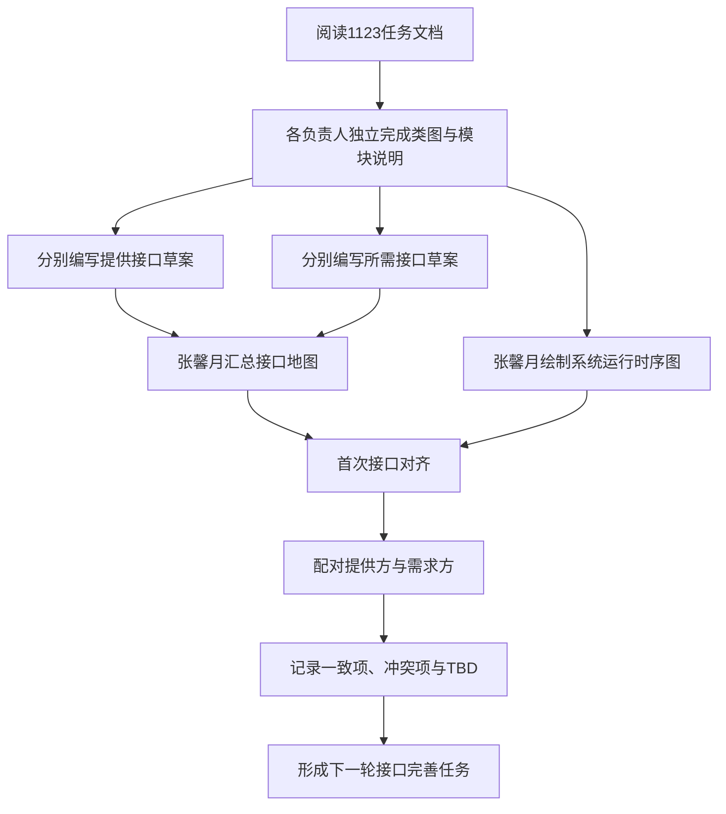

# 开发协作与接口评审流程

> **当前任务金标准：[1123任务文档](tasks/T-008.md)。** 本文说明从当前设计任务走向接口对齐、测试、实现和集成的长期流程。当前成员本周实际需要提交什么，以 1123任务文档为准；本文、网页、Roadmap、PPT 或讲稿与其冲突时，执行 1123任务文档。

## 一、当前阶段：1123任务

当前处于 Phase 0 的模块设计与首次接口草案阶段。目标是让五个责任子系统的内部构成和跨模块需求变得可讨论，为下一次接口对齐准备材料。

### 1.1 当前责任域

| 责任域 | 负责人 | 当前责任 |
|---|---|---|
| Backbone 与整体架构 | 张馨月 | 公共骨架、`Engine`、实验流程、系统时序、接口对齐和集成 |
| Decision、LLM 与 Memory | 杜芃烨 | Decision Layer、Harness/Context、Model Adapter、决策记忆与记录查询 |
| World 与确定性规则 | 张津阁 | 世界初始化、权威物理状态、验证和确定性结算 |
| Market 与 Firm | 王逸忱 | 商品市场、分散式劳动力市场、企业决策问题和 Lange 市场反馈 |
| Planning 与 Labor Allocation | 郝依琳 | Cockshott、Lange 中央计划方和集中式劳动分配 |

李文浩担任技术顾问，负责 LLM、软件架构和计算实验方面的咨询与评审。刘充担任经济学研究顾问，负责制度机制、行为假设和比较公平性的咨询与评审。

### 1.2 当前每位负责人提交的内容

每位子系统负责人完成四项交付：

1. 一张可讨论的类图草案；
2. 一份能够讲清模块内部组成和运作方式的模块设计说明；
3. 本模块每个准备向外提供的接口各写一份接口草案；
4. 本模块每个希望其他模块提供的接口各写一份接口需求草案。

张馨月额外完成一张系统运行时序图。该图说明 `Engine` 如何初始化实验、推进一个正常行动轮、调用其他模块、保存记录并进入下一轮或结束实验。详细要求只需张馨月阅读 1123任务文档第五部分。

### 1.3 当前明确不要求的内容

本轮不要求：

- 正常、边界和失败样例；
- 单元测试、契约测试和集成测试；
- 公共对象最终字段；
- 接口最终版本号；
- 生产功能实现；
- 失败、重试、超时和回退流程定稿；
- 为了显得完整而建立复杂继承体系。

这些内容会在接口对齐和实现任务中逐步补充。教学文档或 PPT 中出现完整测试流程，只代表后续成熟工程方法，不构成 1123任务的当前交付要求。

## 二、当前系统边界

### 2.1 主动流程与权威状态

- `Engine` 属于张馨月负责的 backbone，主动启动实验、推进轮次并按顺序调用其他模块；
- World 被 `Engine` 调用，维护权威物理状态，验证行动和机制结果并完成确定性结算；
- Decision 返回主体提出的结构化行动；
- Market 返回订单、成交、价格、劳动力市场或其他市场协调结果；
- Planning 返回计划、试探价格信号和集中式劳动分配结果；
- Decision、Market 和 Planning 不直接改写权威 WorldState。

### 2.2 Decision 与领域模块

杜芃烨负责通用 LLM 决策执行。具体决策在经济上要解决什么问题，由对应领域负责人共同定义：

- World 提供允许主体看到的世界信息或观察；
- Market/Firm 定义企业需要作出的经济决策、合法行动和市场信息需求；
- Planning 定义中央计划或劳动分配决策所需信息；
- Decision Harness 检索并组装已经允许提供的上下文，调用模型或规则基线并返回结构化结果。

Decision Memory 保存或索引已确认事实的决策侧历史视图，不结算交易，不维护第二套权威世界状态。实验原始产物如何落盘，由 backbone 统一组织。

### 2.3 Market 与 Planning

- 王逸忱负责市场经济中的商品市场和分散式劳动力市场；
- 郝依琳负责计划经济中的集中式劳动分配；
- Lange 中央计划方的试探价格更新由郝依琳负责；
- 试探价格下的订单、出清、供需和市场反馈由王逸忱负责；
- 双方需要在接口对齐会上共同确定一轮 Lange 试错的信息往返方式。

## 三、从当前任务到首次接口对齐

### 3.1 负责人准备材料

每位负责人先说明自己的模块内部准备怎样构成和运作，再分别列出提供和需要的接口。当前可以使用 `TBD`，不需要为了填写模板而提前决定所有字段。

张馨月负责把五份材料放进统一议程，检查：

- 时序图中的跨模块调用是否都有对应接口草案；
- 提供方与需求方是否能够配对；
- 同一项信息是否被多个模块重复定义；
- `Engine`、World、Decision、Market 和 Planning 的调用方向是否一致；
- 尚未确定的问题是否被清楚记录。

### 3.2 首次接口对齐

接口对齐建议按以下顺序进行：

1. 张馨月用系统时序图说明实验启动和一个正常行动轮；
2. 每位负责人用类图和模块说明介绍内部结构；
3. 从时序图第一条跨模块调用开始，逐一匹配提供接口与所需接口；
4. 对照双方草案，确认基本功能、调用方、提供方、暂定 Python 形式、输入和输出；
5. 把无法当场确定的字段、语义、时机和责任写成 `TBD`；
6. 确定每对接口下一轮由谁维护共同文档。

首次对齐的主要产物是配对后的接口清单、确认的边界、未决问题和下一轮任务。它不要求当场完成所有失败语义和契约测试。

## 四、首次接口草案格式

当前提供接口和所需接口分别成文，统一采用 1123任务文档第四部分的最小格式：

1. 基本信息：接口名称、状态、提供方、使用方、用途和调用阶段；
2. Python 形式草案：暂定函数、方法或数据对象形式；
3. 输入信息：暂定类型、含义和是否必需；
4. 输出信息：暂定类型、含义以及属于建议、请求、确认结果还是结算事实；
5. 尚未确定的问题。

接口提供方和需求方本周分别写自己的草案。首次对齐后，如果一份所需接口能够与另一模块的提供接口匹配，双方再合并为一份共同维护的正式接口文档。

## 五、接口对齐后的后续流程

以下内容属于 1123任务之后的阶段，不是本周交付。

### 5.1 完善正式接口

双方完成基本接口配对后，再逐步补充：

- 最终字段、类型、单位、范围和空值语义；
- 调用频率、轮内时机和版本；
- 权限、失败、重试和回退；
- 副作用和状态变化责任；
- 正常、边界、非法和失败样例；
- 兼容与迁移方式。

### 5.2 共同设计契约测例

提供方最了解行为承诺，需求方最了解真实调用场景。双方共同确认跨模块契约测例；各模块负责人独立维护模块内部单元测试。

测试分为：

- 单元测试：验证模块内部规则；
- 契约测试：验证接口双方对同一语义的理解；
- 集成测试：验证若干真实模块可以连接；
- 端到端测试：验证最小世界能够完成一轮或多轮运行。

### 5.3 技术与经济学评审

接口、样例和测试方案形成后：

- 张馨月检查依赖、接口完整性和集成可行性；
- 李文浩检查 LLM、软件架构、计算实验与复现；
- 刘充检查经济机制、信息条件、价格与计划逻辑；
- 模块负责人回答内部设计、实现范围和工作量问题。

需要先由张馨月和刘充双人批准再向团队开放的重大修改，采用 [受控提案双人评审工作流](../project/workflows/gated-proposal-review.md)。

### 5.4 实现公共骨架

接口评审后进入 Phase 1：

- 张馨月实现配置装配、公共骨架、空 `Engine`、运行生命周期和记录入口；
- 各负责人提供符合已确认接口的空实现、Stub 或固定结果；
- 先跑通一条固定结果的最小路径；
- 再分别补充 World、Market、Planning 和 Decision 的真实逻辑。

### 5.5 并行实现与持续集成

建议设置以下集成节点：

1. 空骨架与固定结果可以完成一轮；
2. 无 LLM 的确定性世界可以多轮运行；
3. 三类简化机制通过极小案例；
4. LLM Decision 接入并记录成本与失败；
5. 正式实验配置可以批量运行和复现。

张馨月组织集成并定位问题所属模块。具体修复由对应模块负责人完成，公共接口变化必须通知所有使用方。

## 六、长期阶段路线

### Phase 1：公共骨架

- 配置解析与组件装配；
- 公共数据结构；
- 空 `Engine` 和空模块接口；
- 一轮固定结果可以运行；
- 基础运行记录可以落盘。

### Phase 2：无 LLM 的确定性世界

- 世界初始化；
- 生产、运输、消费和健康；
- 守恒和可复现测试；
- 使用固定行为运行多轮。

### Phase 3：三个简化机制

- 简单市场出清；
- 简单 Lange 价格试错；
- 简单 Cockshott 静态计划；
- 简单岗位或劳动匹配；
- 手算极小案例验证。

### Phase 4：接入 LLM

- Observation 与领域上下文；
- Prompt、Harness 和模型适配；
- 结构化行动；
- Decision Memory；
- 预算和失败处理；
- 与规则基线比较。

### Phase 5：正式实验

- 多 seed；
- 公平信息条件；
- 冲击与消融；
- 置信区间和失败轨迹；
- 完整成本记录。

## 七、Git 与集成

- 每项任务在负责人自己的分支上完成；
- 不直接在受保护分支开发；
- Pull Request 说明修改范围、接口影响和已完成验证；
- 当前集成策略和评审要求以 [Git 工作流](git-workflow.md) 为准；
- 提案在合入团队集成分支前不构成正式基线；
- 通过评审并合入后，其他成员才从最新集成基线继续工作。

## 八、阶段完成的判断

当前 1123任务完成条件以金标准文档为准。后续实现阶段的通用完成条件包括：

- 任务约定范围完成；
- 公共接口与正式文档一致；
- 对应测试通过；
- 配置和运行方式可复现；
- Pull Request 清楚说明影响和限制；
- 张馨月完成集成检查；
- 需要专业评审的内容已经由李文浩或刘充确认。
