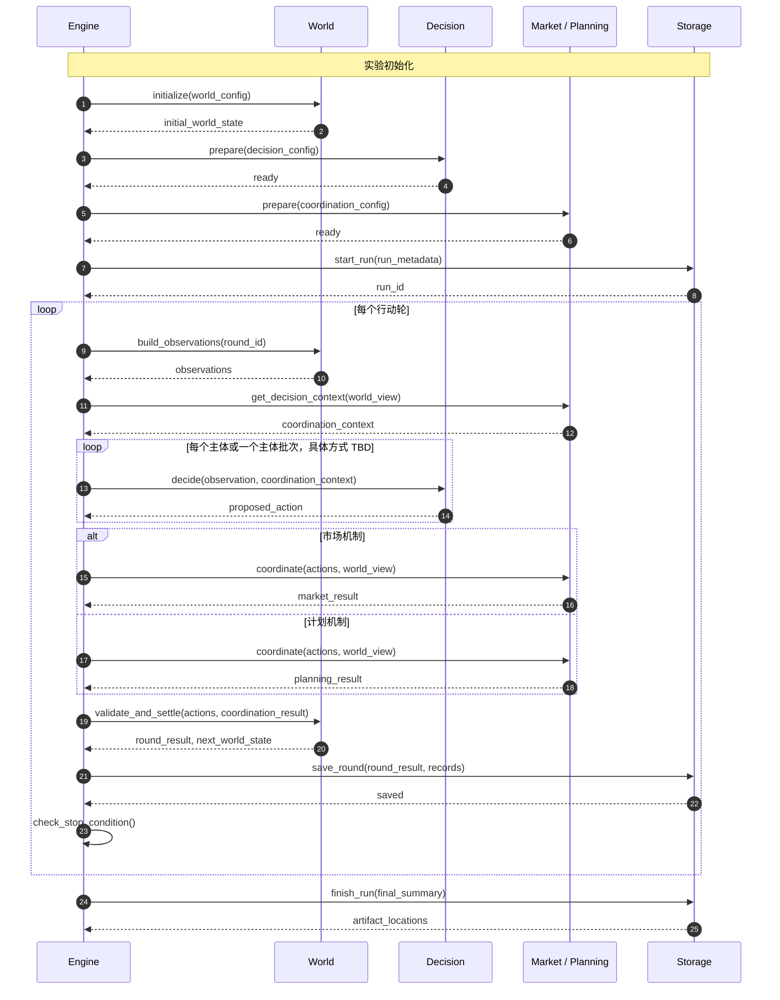

# 1123任务文档

- 文档编号：T-008
- 对应讨论：2026-11-23 20:00–24:00
- 协调与集成：张馨月
- 架构评审：李文浩
- 状态：已完成初步分工，待接口对齐
- 阶段：Phase 0，第一次接口对齐前

> **金标准声明：本文档是 2026 年 11 月 23 日讨论形成的任务金标准。** 本轮成员分工、交付物、类图要求、接口草案格式、完成范围和张馨月负责的系统运行时序图，均以本文档为准。其他 README、开发流程文档、架构说明、网页、Roadmap、PPT 和讲稿只用于提供背景或辅助理解；如其内容与本文档冲突，应执行本文档，并把冲突记录为待同步事项。

## 一、确定后的整体分工

本轮按“整体调度、决策与记忆、世界规则、市场机制、计划机制”划分工作。下表先确定责任边界，具体类名、方法名和输入输出仍由各负责人提出，并在接口对齐后统一。

| 子系统 | 负责人 | 主要职责 | 本轮重点 | 关键边界与协作关系 |
|---|---|---|---|---|
| Backbone 与整体架构 | 张馨月 | 公共骨架、`Engine`、实验运行流程、跨模块集成和公共约定 | 说明整体结构，画系统时序图，组织各模块接口对齐 | `Engine` 主动推进实验并调用其他模块；不代替各负责人设计领域算法 |
| Decision、LLM 与 Memory | 杜芃烨 | 通用决策执行框架、上下文与工具调用、模型适配、决策记忆与历史记录查询 | 说明三层决策结构以及记忆/记录结构，列出所需上下文和输出决策接口 | 其他模块提供领域上下文和决策要求；本模块不修改权威世界状态，也不决定市场或计划机制的经济规则 |
| World 与确定性规则 | 张津阁 | 世界初始化、世界数据模型、生产与生活规律、行动验证和确定性结算 | 说明世界由哪些对象构成、规则如何被调用、状态如何演化 | World 被 `Engine` 调用；负责世界规律与权威物理状态，不负责实验总流程调度 |
| Market 与 Firm | 王逸忱 | 分散市场机制、商品与劳动力市场、企业决策问题 | 说明市场组成、订单与出清过程、企业如何形成生产和交易决策 | Lange 所需的市场执行与反馈由本模块提供，Lange 中央计划方的调价逻辑由郝依琳负责；物理状态最终由 World 结算 |
| Planning 与 Labor Allocation | 郝依琳 | Cockshott 计划机制、Lange 中央计划机制、集中式劳动分配机制 | 说明三种机制的组成、输入、计算过程和输出 | 调用市场模块获得 Lange 的市场反馈；向 `Engine` 和 World 返回计划或分配结果，不直接改写世界状态 |

### 1.1 张馨月：Backbone 与整体架构

张馨月负责让整个实验能够从开始运行到结束，并把其他四个子系统接到同一条运行流程中。主要内容包括：

- 设计公共 backbone 和项目代码的总体组织方式；
- 负责 `Engine`，由 `Engine` 启动实验、推进轮次并按约定顺序调用各模块；
- 组织实验配置加载、模块装配、运行生命周期和实验结果归档；
- 汇总各模块提出的公共对象和接口，组织接口对齐，并维护最终采用的公共约定；
- 负责跨模块集成，使一次最小实验能够完整运行；
- 绘制系统运行时序图，说明初始化、单轮运行、记录和结束实验的调用顺序。

张馨月负责整体流程和公共骨架，不需要替其他负责人决定 LLM 提示词、世界规律、市场出清算法或计划算法。领域模块负责说明自己能提供什么能力，`Engine` 负责在合适的时间调用这些能力。

### 1.2 杜芃烨：Decision、LLM 与 Memory

杜芃烨负责“主体在给定信息下如何形成决策”的通用执行能力。其他模块需要说明某类决策允许看到哪些信息、需要输出什么行动；本模块负责把这些要求组织成可执行的决策流程。初步分为三层：

1. **Decision Layer**：针对不同决策场景组织相应的决策器。每一种场景应能说明使用什么上下文、要回答什么问题、返回什么结构化决策。具体经济含义由对应领域负责人共同确定；例如企业决策的问题定义和可选行动由王逸忱负责，本层负责承载和执行相应的 LLM 决策流程。
2. **Harness / Context Layer**：组装一次决策所需的上下文，查询允许读取的世界信息、机制信息和历史记忆，调用必要工具，并检查模型输出能否解析成约定的决策对象。
3. **Model Adapter Layer**：屏蔽不同模型的调用差异，能够接入远程 API、本地模型以及不使用 LLM 的规则或基线决策器。上层不应依赖某一家模型的专用返回格式。

杜芃烨还负责决策侧的 Memory 与记录查询能力，其用途包括保存主体可继承到后续轮次的决策记忆，以及按主体、机构、轮次或事件检索过去的信息，为后续决策构造上下文。这里需要区分三类内容：

- 库存、健康、位置、生产结果等权威世界事实由 World 维护；
- 订单、成交、价格、劳动分配和计划结果由相应机制产生，并交给整体流程记录；
- Memory 读取上述已确认的事实，保存或索引决策需要的历史视图、摘要和主体记忆，不自行结算交易，也不另行生成一套相互竞争的权威状态。

实验级原始记录如何落盘、目录如何组织以及一次运行保存哪些文件，由张馨月在 backbone 中统一组织；杜芃烨需要提供模型调用记录、决策记录和记忆更新等可保存内容。这里暂用 “Memory 与记录访问” 描述，最终是否拆成 `DecisionMemory`、`RecordStore` 等类，由类图和接口对齐共同决定。

### 1.3 张津阁：World 与确定性规则

张津阁负责世界本身的定义和确定性演化规律。这个子系统接受 `Engine` 的调用，根据输入和既定规则返回结果，属于被动提供能力的模块。主要内容包括：

- 根据实验参数初始化地图、主体、设施、资源和初始世界状态；
- 定义世界中的核心对象，以及运行中需要维护的权威物理状态；
- 实现生产、运输、消费、健康、库存和其他自然或物理规律；
- 验证行动是否满足权限、容量、资源和时间等约束；
- 根据已经确认的行动和机制结果完成确定性结算，并产生下一状态或结算结果；
- 提供其他模块被允许读取的世界信息或观察结果。

张津阁与张馨月的边界是：张津阁说明“世界按照什么规律变化”，张馨月说明“实验何时调用哪条规律并怎样推进完整流程”。配置文件的通用读取和对象装配可以放在 backbone，如何用配置生成具体世界以及如何结算仍由 World 负责。

### 1.4 王逸忱：Market 与 Firm

王逸忱负责分散市场如何交换资源，以及企业在市场环境中如何形成经营决策。初步包含：

- 一个可按商品类型复用的商品市场，用于粮食、铁等商品的订单提交、订单簿、撮合或出清和成交结果；
- 市场经济情形下的分散式劳动力市场，用于企业发布劳动需求、劳动者提供劳动以及双方匹配；
- 企业决策问题，包括生产计划、劳动需求、投入品购买、产品出售、报价或下单等内容；
- 向其他模块提供订单、价格、成交、超额供需或其他市场反馈。

粮食市场和铁市场是否复用同一套通用商品市场类，应在类图中先提出方案；当前不要求预先拆成两套独立实现。

企业决策需要与杜芃烨协作：王逸忱负责定义企业在经济上要决定什么、允许参考什么信息、行动需要包含哪些内容，并可以提供确定性基线；杜芃烨负责通用 LLM 决策执行、上下文装配和模型调用。王逸忱还需要与郝依琳对齐 Lange 机制：本模块负责市场订单、出清和反馈，郝依琳负责中央计划方怎样根据反馈调整试探价格。市场返回的成交或调拨结果应交给 World 验证和结算，不直接改写权威世界状态。

### 1.5 郝依琳：Planning 与 Labor Allocation

郝依琳负责两种中央计划机制及其集中式劳动配置。初步包含：

- **Cockshott Central Planning Process / Planner**：根据需求、资源、技术条件等信息计算生产计划，并根据项目采用的理论设定设计反馈与调整过程；
- **Lange Central Planning Process / Planner**：维护试探价格，读取市场模块返回的供需或出清反馈，并按照 Lange 规则更新价格和计划信号；
- **Central Labor Allocation**：在计划经济情形下，根据岗位需求、劳动者信息和计划目标完成集中式岗位或劳动分配。

这里的 `CPP` 暂时理解为 Central Planning Process 或 Central Planner，最终英文全称需要在接口对齐时统一。集中式劳动分配与王逸忱负责的分散式劳动力市场是两套制度下的实现，不应合并为同一个算法。郝依琳输出计划、价格信号或劳动分配结果，`Engine` 负责安排调用顺序，World 负责验证并落实为世界状态变化。

### 1.6 当前必须共同确认的边界

各负责人在画图和写接口时，优先把下面几处写清楚；如果暂时没有结论，可以标记为 `TBD`：

- 哪些决策场景由 LLM 执行，哪些使用确定性规则或基线；
- 每类决策上下文由谁定义、谁提供，杜芃烨的 Harness 如何获取；
- Decision Memory、机制内部状态、权威 World 状态和实验落盘记录各自保存什么；
- 市场经济中的劳动力市场与计划经济中的集中式劳动分配分别需要哪些信息；
- Lange 中央计划方与市场执行层之间一轮内如何往返，以及何时停止试错；
- 企业决策的领域定义与通用 LLM 决策执行如何衔接；
- 机制结果由 World 验证和结算时，需要返回哪些成功、拒绝或调整信息。

## 二、本周任务

每位负责人完成以下四项工作：

1. 每个子系统形成一张可讨论的类图草案；
2. 准备一份能够讲清本模块内部组成和运作方式的模块设计说明材料；
3. 本模块每个准备向外提供的接口各写一份接口文档；
4. 本模块每个希望其他模块提供的接口各写一份接口需求文档。

此外，张馨月负责 Engine 与整体流程，需要补充一张系统运行时序图。时序图用于把各模块在运行时如何接起来讲清楚，并与四位负责人的类图和接口草案一起参加下一次接口对齐。

本周的目标是把每个子系统的基本结构和跨模块协作需求讲清楚，为下一次接口对齐提供可以直接讨论的材料。当前产出都是草案，可以保留 `TBD` 和未决问题。

公共对象的最终名称和完整字段、正常/边界/失败样例、测试用例及具体实现代码，本周暂不要求完成。

### 2.1 类图草案

每位负责人为自己负责的子系统画一张类图草案。类图应尽量体现：

- 本模块的主要类和关键数据对象；
- 如果当前设计中确实需要独立的状态类或存储数据类，也将它们画出来；
- 主要公共方法；
- 类之间的调用、组合、接口实现或继承关系；
- 本模块与其他子系统的边界；
- 当前仍未确定的结构。

只画主要结构，重点是让其他成员看懂“这个模块准备由哪些部分组成，各部分怎样协作”。辅助函数、临时变量和具体算法可以省略。

状态类和存储数据类只是可能出现的设计，并非每个模块都必须具有，也不要求一定拆成独立的类。是否需要这些类、是否拆成独立的 `dataclass`、由哪个模块负责定义，应由具体模块负责人、相关接口方与负责整体架构和集成的张馨月共同讨论决定。

如果最终决定使用只负责组织字段、不承担复杂业务流程的纯数据对象，可以优先使用 `dataclass`，并在类图中将其标为数据类。下面这些名称仅用于帮助理解，并不表示本项目必须建立这些类：

- 状态数据类示例：`WorldState`、`DecisionMemory`、`LangeState`、`OrderBookState`；
- 存储数据类示例：`ActionRecord`、`RoundRecord`、`CoordinationResultRecord`、`LLMCallRecord`。

负责人可以在设计过程中思考哪些数据只在一次计算中临时使用，哪些数据可能延续到下一轮，哪些数据可能需要写入实验记录。这些思考有助于判断是否需要独立的数据类，本周不要求另外编写状态说明文档。

### 2.2 模块设计说明材料

每位负责人需要用一份材料，把自己负责的模块完整地介绍给其他成员。材料形式不限，可以使用：

- PowerPoint；
- HTML 页面；
- Markdown 文档；
- 其他便于共享和查看的形式。

这项任务不强调正式演讲，也不要求制作复杂页面。验收标准是其他成员阅读或听完介绍后，能够理解：

- 这个模块负责解决什么问题；
- 模块内部准备分成哪些主要部分；
- 每个部分分别负责什么；
- 这些部分在一次正常运行中怎样配合；
- 本模块从哪些外部模块获得信息；
- 本模块会向哪些外部模块提供结果；
- 当前有哪些结构或流程还没有确定。

类图可以直接放进这份材料中。对于类图不容易表达的运行过程，可以补充流程图、时序图或一段按步骤书写的文字。材料重点是说明设计思路，不要求编写实现代码。

### 2.3 本模块提供的接口

每个准备向外提供的接口单独写一份接口文档，使用第四部分的统一格式。每份文档至少说明：

- 本模块提供什么功能或信息；
- 哪些模块会调用；
- 大致在什么阶段调用；
- 调用方需要传入什么信息；
- 本模块会返回什么信息；
- 当前有哪些问题需要共同确定。

### 2.4 本模块需要的接口

每个希望其他模块提供的接口也单独写一份接口需求文档，使用同一格式。每份文档至少说明：

- 希望哪个模块提供；
- 本模块为什么需要；
- 希望在什么阶段调用；
- 本模块准备传入什么信息；
- 本模块希望获得什么信息；
- 当前有哪些问题需要共同确定。

提供接口和所需接口可以放在同一份模块设计说明材料中一起介绍，但书面任务需要分别列出、逐个成文。第一次接口对齐时，如果一个“所需接口”能够与另一个模块的“提供接口”对应，再由双方合并为一份共同维护的正式接口文档。

### 2.5 张馨月：系统运行时序图

张馨月额外完成一张系统运行时序图。详细说明见第五部分；第五部分仅张馨月需要阅读和完成，其他成员无需阅读。

### 2.6 文档组织建议

建议每位负责人按下面的方式整理本周材料：

```text
<module-name>/
├── module-design.<md|html|pptx>
├── class-diagram.<md|png|drawio>
├── provided/
│   ├── <provided-interface-1>.md
│   └── <provided-interface-2>.md
└── required/
    ├── <required-interface-1>.md
    └── <required-interface-2>.md
```

张馨月的整体时序图可以单独保存为 `system-sequence-diagram.<md|png|drawio|puml>`，也可以放入她的整体流程说明材料中。实际存放位置由张馨月统一安排。本节只规定交付物之间的关系。

## 三、类图教程及相关材料

### 3.1 类图是什么，为什么要画

类图是一张描述程序静态结构的图。它关注“程序里准备有哪些类或数据对象”“每个类主要负责什么”“它们之间是什么关系”，不负责画程序从第一步到最后一步的执行过程。

对本项目来说，画类图的主要作用是让一个模块的负责人先把自己的设计讲清楚，也让其他成员能够提前发现职责重复、依赖缺失或边界模糊的问题。例如，市场模块准备包含订单收集、订单簿和市场出清等部分，就可以先把这些类及其关系画出来，再讨论它们是否划分合理。类图是一份设计草案，后续随着接口对齐和代码实现继续修改是正常的。

#### 怎样从模块职责找到候选类

可以先用几句话描述模块完成工作的过程，再从中寻找重要名词和职责。例如：

> 市场模块接收主体提交的订单，将订单放入订单簿，按照出清规则进行匹配，并把成交结果交给 Engine。

这段话中，`MarketSystem`、`Order`、`OrderBook`、`ClearingRule` 和 `MarketResult` 都可能成为候选类或数据对象。然后再逐个判断：

- 它是否代表一个需要独立管理的概念；
- 它是否拥有自己的数据或行为；
- 它是否会被其他类调用或持有；
- 它是否只是一个普通字段或简单函数，没有必要单独成为类。

类并非越多越好。一个概念只有在具有明确职责时才需要单独画成类。

#### 类框中通常写什么

一个类框一般分为三层：

```text
+-------------------------------+
| MarketSystem                  |  类名
+-------------------------------+
| - order_book: OrderBook       |  重要属性
+-------------------------------+
| + collect_orders(...)         |  主要公共方法
| + clear_market(...)           |
+-------------------------------+
```

- 第一层写类名，使用英文 `PascalCase`；
- 第二层写理解设计所必需的重要属性；
- 第三层写其他模块或其他类需要调用的主要方法；
- `+` 一般表示公开成员，`-` 一般表示仅供类内部使用的成员。

这周不要求把所有属性和方法全部列出来。只保留能说明类的职责和协作方式的内容即可。

#### 状态类和存储数据类

有些模块可能需要独立的状态类或存储数据类，有些模块只需要少量普通字段。是否需要这些类、是否把它们拆成独立对象，以及由哪个模块负责定义，需要由具体模块负责人、相关接口方与张馨月结合整体架构和集成方式共同讨论。类图不要求为了形式完整而额外创建状态类或存储数据类。

如果设计中确实需要只负责组织字段、不承担复杂业务流程的纯数据对象，可以优先使用 `dataclass`，并在类图中将其画成数据类。`dataclass` 是 Python 中用于组织一组相关字段的数据类。使用 `@dataclass` 后，Python 会自动生成初始化等基础代码，适合表达状态、输入输出和实验记录。它与负责执行复杂流程的普通业务类分工不同。

- **状态数据类示例**：`WorldState` 可以表示当前世界状态，`DecisionMemory` 可以表示 Decision 模块保留的记忆，`LangeState` 可以表示 Lange 机制需要延续到后续计算的信息。这些名称只是示例，并不表示每个模块都要建立对应的类。
- **存储数据类示例**：`RoundRecord` 可以保存一轮摘要，`ActionRecord` 可以保存主体行动，`LLMCallRecord` 可以保存一次 LLM 调用的模型、耗时和成本信息。这些类是否需要独立存在，也要结合实际存储方案决定。

如果使用数据类，一个数据类可以同时服务运行和存储，类图中应写清它的用途。函数内部临时列表、局部变量和很小的中间结果通常不需要画成数据类。

在类图中可以用 `<<dataclass>>` 标记：

```text
+-------------------------------+
| <<dataclass>>                 |
| LangeState                    |
+-------------------------------+
| trial_prices: PriceVector     |
| iteration: int                |
+-------------------------------+
```

#### 本周常用的关系

| 关系 | 通俗解释 | 示例 |
|---|---|---|
| 依赖或调用 | 一个类在工作时会调用另一个类 | `Engine` 调用 `MarketSystem` |
| 关联 | 一个类长期知道或持有另一个对象 | `MarketSystem` 持有 `ClearingRule` |
| 组合 | 一个对象由若干组成部分构成，组成部分主要随它一起存在 | `OrderBook` 包含多条 `Order` |
| 继承 | 子类继承父类已有的行为，二者确实存在“是一种”的关系 | 某个具体实现继承稳定的公共基类 |
| 接口实现 | 某个类实现了一组约定好的方法 | 多种机制满足同一个公共接口 |

初稿中不确定该用哪一种箭头时，可以先画普通依赖并写清用途，之后再调整。不要为了让图显得完整而强行使用继承、聚合或组合。

#### 类图画到什么程度

本周的类图达到以下程度即可：

- 其他成员能够看懂本模块的主要组成；
- 每个主要类都有相对清楚的职责；
- 主要公共方法能够与接口草案对应；
- 与其他子系统发生联系的位置能够被看见；
- 暂时无法确定的地方明确标记为 `TBD`。

常见问题包括：把所有函数和字段都画进去，导致图无法阅读；只列类名，不说明职责和关系；把执行步骤画成类图；为了消除少量重复而提前设计复杂继承树；把其他成员负责的模块完整展开。跨模块部分只需画出与自己有关的边界和依赖，不需要替对方完成内部设计。

### 3.2 建议先看

1. [Visual Paradigm：使用图书馆系统一步步画类图](https://skills.visual-paradigm.com/docs/uml-basics-diagrams-for-beginners/mastering-class-diagrams-beginner/class-diagram-example-simple-uml-project/)
   - 使用图书馆、图书、成员和借阅记录完成一张小型类图；
   - 适合第一次接触类图时理解怎样寻找类、属性、方法和关系。

2. [Visual Paradigm 中文类图综合指南](https://blog.visual-paradigm.com/cn/from-concept-to-code-a-comprehensive-uml-class-diagram-guide-case-study/)
   - 中文介绍继承、接口实现、关联、聚合、组合和多重性；
   - 可以作为常用符号的快速参考。

### 3.3 需要时查阅

1. [Visual Paradigm：UML Class Diagram Tutorial](https://www.visual-paradigm.com/guide/uml-unified-modeling-language/uml-class-diagram-tutorial/)
   - 系统介绍类、属性、方法、可见性和各种关系；
   - 画图时不确定箭头含义，可以回到这篇查阅。

2. [Real Python：Inheritance and Composition](https://realpython.com/inheritance-composition-python/)
   - 同时展示 Python 代码和 UML 图；
   - 适合理解继承、组合、接口和实际 Python 类之间的对应关系。

### 3.4 本项目的类图约定

- 类、接口和数据类型使用英文 `PascalCase`。`PascalCase` 表示每个单词的首字母大写，单词之间不加空格和下划线，例如 `MarketSystem`、`WorldState`、`RoundResult`；
- 方法、参数和字段使用英文 `snake_case`。`snake_case` 表示全部使用小写字母，单词之间用下划线连接，例如 `clear_market`、`agent_id`、`round_result`；
- 只画对理解模块结构有帮助的属性和方法；
- 跨模块依赖应标明方向和用途；
- 暂时不能确定的类或关系可以标记为 `TBD`；
- 类图是设计草案，不要求与最终实现完全一致。

## 四、接口文档、参考材料及 Python 规定

### 4.1 接口是什么

接口可以理解成两个模块之间约定好的“使用方式”。它需要说明由谁提供、由谁调用、什么时候调用、调用时交付什么信息，以及调用完成后能够获得什么信息。

例如，Engine 需要市场模块完成市场出清。市场模块是接口提供方，Engine 是调用方。双方需要共同确认：Engine 应传入哪些订单和状态信息，市场模块返回哪些成交或未成交信息，以及这些返回值代表建议、请求还是已经确认的结果。

接口和具体实现是两件事。接口说明外部怎样使用这个模块；实现说明模块内部怎样完成计算。同一个接口以后可以有不同实现，只要它们遵守相同的输入、输出和含义约定。第一次接口草案主要讨论模块边界和信息交换，不要求提前写出内部算法。

接口文档由提供方先起草，调用方检查信息是否足够、调用方式是否合理，双方共同维护同一份文档。先写接口可以帮助各成员在独立开发前确认连接方式，减少后续集成时才发现输入缺字段、输出无法使用或职责相互重叠的情况。

本周处在接口对齐之前，因此提供方和提出需求的一方先分别写自己的草案：提供方说明“我准备提供什么”，需求方说明“我希望获得什么”。两份草案在接口对齐会上匹配成功后，再合并成一份双方共同确认的接口文档。介绍模块设计时，可以把提供接口和所需接口放在一起讲，便于大家理解完整的信息流。

### 4.2 接口文档参考材料

1. [MIT Software Construction：Specifications](https://web.mit.edu/6.005/www/fa14/classes/06-specifications/)
   - 将接口理解为提供方与调用方之间的契约；
   - 重点说明输入条件、输出保证、状态影响和异常的含义；
   - 示例使用 Java，但接口设计思想同样适用于 Python。

2. [arc42：Building Block View](https://docs.arc42.org/section-5/)
   - 说明如何描述模块职责、外部接口和模块之间的依赖；
   - 本周重点参考其中的黑盒模块说明方法。

3. [arc42 实际项目的 Building Block View](https://examples.arc42.org/systems/biking/05-building-block-view/)
   - 可以直接查看一个实际系统如何记录模块、职责、接口和代码位置。

4. [Cosmic Python：Repository Pattern](https://www.cosmicpython.com/book/chapter_02_repository)
   - 通过完整 Python 示例说明抽象接口、调用方、具体实现和测试替身之间的关系；
   - 内容较长，作为扩展阅读使用。

### 4.3 首次接口草案统一格式

本周所有“提供接口草案”和“所需接口草案”都使用下面的格式，并且每个接口单独成文。第一次接口对齐后，能够匹配的提供草案与需求草案再合并为一份共同维护的接口文档。

````markdown
### Interface: <暂定接口名称>

#### 1. 基本信息

- 提供方：
- 调用方：
- 主要功能：
- 大致调用时机：
- 当前状态：`PROPOSED`

#### 2. Python 形式草案

```python
def method_name(
    request: RequestType,
) -> ResponseType:
    ...
```

当前无法确定的方法名或类型可以写 `TBD`。

#### 3. 输入信息

| 信息 | 暂定 Python 类型 | 含义 | 是否必需 |
|---|---|---|---|
|  |  |  |  |

只需说明接口需要什么信息，暂不要求确定完整字段。

#### 4. 输出信息

| 信息 | 暂定 Python 类型 | 含义 | 是否一定提供 |
|---|---|---|---|
|  |  |  |  |

请说明输出属于建议、请求、已确认结果、已结算事实或诊断信息。

#### 5. 尚未确定的问题

- （待填写）
````

### 4.4 Python 规定

#### 1. 纯数据对象优先考虑 `dataclass`

跨模块输入输出、模块状态和实验存储记录如果被设计为只负责组织字段的纯数据对象，可以优先使用 `dataclass` 表达：

```python
from dataclasses import dataclass


@dataclass(frozen=True)
class Observation:
    agent_id: str
    round_id: int
```

是否需要独立的数据类、如何拆分、由谁定义，需要由模块负责人、相关接口方与张馨月共同讨论。上面的 `Observation` 只是一种写法示例。只读数据可以使用 `frozen=True`；需要在模块内部逐步更新的数据是否使用 `frozen=True`，由负责人根据更新方式决定。完整字段在接口对齐和模块设计完善后确定。

#### 2. 类型名称应表达数据含义

推荐：

```python
def decide(observation: Observation) -> Action:
    ...
```

避免：

```python
def decide(data: dict) -> dict:
    ...
```

如果当前无法确定类型，可以在草案中使用 `TBD`，并将原因列入“尚未确定的问题”。

#### 3. 命名统一使用英文

- 类、接口和数据类型使用 `PascalCase`：每个单词首字母大写，不使用下划线，例如 `MarketSystem`、`WorldStateView`；
- 函数、方法、参数和字段使用 `snake_case`：全部小写，单词之间使用下划线，例如 `clear_market`、`work_hours`；
- 常量使用 `UPPER_CASE`：全部大写，单词之间使用下划线，例如 `MAX_RETRY_COUNT`、`DEFAULT_TIMEOUT`。

#### 4. 跨模块状态变化由 Engine 统一组织

各模块在“输出信息”中说明自己返回的是建议、请求、已确认结果、已结算事实还是诊断信息。张馨月根据整体流程确定 Engine 如何传递这些结果，以及由哪个状态拥有者执行后续变化。本周无需为此单独填写状态修改清单。

#### 5. 对齐后每个接口只维护一份共同文档

- 本周提供方和需求方分别写自己的草案；
- 接口对齐时，双方确认输入输出是否足够并合并重复草案；
- 张馨月负责汇总跨模块接口和冲突；
- 对齐完成后，由提供方维护唯一的正式接口文档，调用方参与评审；
- 未经相关双方确认，接口状态保持为 `PROPOSED`。

## 五、张馨月专用：系统运行时序图说明

> **本部分仅由张馨月阅读和完成。其他成员完成第二部分中规定的类图、模块设计说明和接口草案即可，无需阅读本部分。**

张馨月负责 `Engine` 和整体运行流程，需要画一张系统运行时序图。类图主要说明“系统里有哪些类和模块”，时序图主要说明“一次实验真正运行起来以后，谁先做什么、接下来调用谁、信息怎样传递”。这张图应站在系统整体视角组织流程，不需要代替各负责人设计模块内部算法。

### 5.1 时序图需要覆盖的内容

- **实验初始化与开始**：`Engine` 如何接收实验配置，如何请求 World 完成初始化，以及 Decision、Market、Planning、Storage 等组件在开始运行前需要怎样准备；
- **一个正常行动轮**：从本轮开始到本轮结束，`Engine` 按什么顺序调用 World、Decision、Market、Planning 和 Storage；
- **循环或批量调用**：Decision 是逐个主体调用、批量调用还是暂时未定；机制是每轮调用一次还是按商品、区域等多次调用。暂时没有结论时直接标记 `TBD`；
- **主要信息传递**：每次调用大致传入什么、返回什么，例如 World 提供主体可见信息，Decision 返回行动，Market 或 Planning 返回协调结果，World 返回验证和结算结果，Storage 接收需要保存的记录；
- **轮次结束与进入下一轮**：本轮结果何时保存，`Engine` 如何判断继续下一轮或结束实验，以及下一轮从哪里重新开始；
- **未决接口**：目前尚未统一名称、字段或调用方式的部分，应在图中或图旁明确标为 `TBD`，供接口对齐时讨论。

### 5.2 本周绘制范围

本周的时序图只画一条能够正常完成的主流程，不要求加入超时、重试、异常、回退等失败分支，也不要求确定所有公共对象的最终字段。各模块内部如何生成提示词、撮合订单、计算计划或执行生产结算，也不在这张整体时序图中展开；这些内容由各模块负责人在自己的类图和模块设计说明中表达。

时序图可以使用 Mermaid 的 `sequenceDiagram`、PlantUML、draw.io，或者其他能够清楚表达参与者、调用顺序和返回信息的格式。工具不限，重点是其他成员能够直接看懂并提出修改意见。

### 5.3 完成标准

- 能从实验开始顺着图读到一个行动轮结束，并看见如何进入下一轮或结束实验；
- `Engine`、World、Decision、Market、Planning 和 Storage 都在图中出现，主要调用方向清楚；
- 关键调用能够看出发起方、接收方、调用顺序以及大致输入输出；
- 循环、批量调用和暂未确定的部分有清楚标记；
- 图中没有替其他负责人提前决定模块内部算法；
- 图能够与四位负责人的材料互相核对：类图中的跨模块公共方法应能在时序图中找到使用位置，接口草案中的提供方和调用方应与时序图方向一致，时序图中出现的跨模块调用也应能找到对应的接口草案。发现对不上时，将其记录为接口对齐时需要处理的问题。

### 5.4 时序图示例

下面是一份可以直接复制到支持 Mermaid 的 Markdown 编辑器中查看的示例。它只用于展示时序图怎样表达参与者、调用顺序、循环、条件分支和返回结果。图中的接口名称、参数、调用次数和先后顺序都是暂定内容，不代表项目已经确定采用这套设计。



阅读这张示例图时，可以按下面的方式理解：

1. `Engine` 是流程发起者，负责初始化模块并推进每个行动轮；
2. World 生成当前轮允许主体看到的信息；
3. Market 或 Planning 提供本轮决策需要的制度环境信息；
4. `Engine` 调用 Decision，获得主体提出的行动；
5. Market 或 Planning 根据行动完成市场协调或计划协调；
6. World 验证行动和机制结果，并完成确定性结算；
7. Storage 保存本轮记录，`Engine` 决定进入下一轮还是结束实验。

张馨月绘制正式草案时，不需要照搬这个顺序。若实际设计中某类信息由 `Engine` 预先组装、Decision Harness 主动查询，或者 Lange 机制在一次行动轮内需要多次试错，应根据四位负责人的接口草案修改调用方向并增加循环。仍未确定的地方直接写 `TBD`，留到接口会议共同决定。
